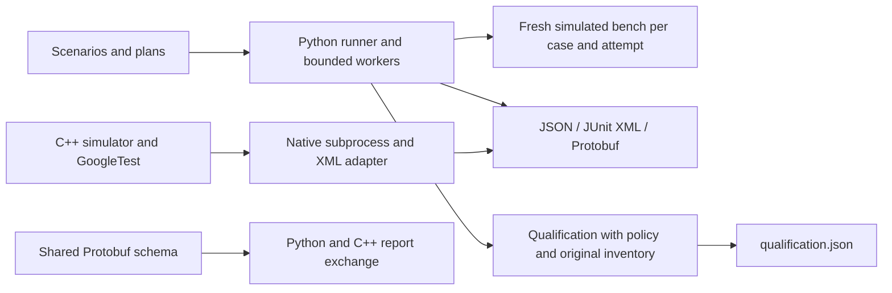

# HIL Bench

HIL Bench runs YAML test scenarios against software-simulated voltage,
temperature, and connection state. It records individual test outcomes, retries,
and failure diagnostics, then evaluates completed runs against release policies.
It does not connect to physical hardware.

The project uses Python, PyYAML, pytest, C++17, CMake, GoogleTest, Protobuf, and
GitHub Actions. Python manages execution and reporting; C++ provides an independent
bench simulator and native tests. A shared Protobuf schema supports report exchange
between the two languages.

## Quick start

Use Python 3.10 or newer on macOS or Linux. CI tests Python 3.10–3.12.

```bash
python3 -m venv .venv
source .venv/bin/activate
python -m pip install -e ".[dev]"
hil-run --version
hil-run --doctor
hil-run scenarios/smoke.yaml --report reports/smoke.json
hil-run scenarios/recovery.yaml --report-format protobuf --report reports/recovery.pb
python -m pytest -q
```

For a regular installation, use `python -m pip install .`. Generated Python
Protobuf bindings are bundled, so Python-only execution needs neither CMake nor
protoc. Scenarios, plans, policies, and developer tools are used from this checkout.

`--doctor` checks required Python dependencies and bundled bindings without
running tests. Missing required components return exit code 2; missing optional
native tools do not fail a Python-only installation. Native checks report
availability, not compiler compatibility or successful execution.

## Architecture



`config.py` and `plans.py` validate execution inputs. `runner.py` executes steps,
while `orchestration.py` runs suites sequentially or with bounded thread workers.
`reporting.py` and `protobuf.py` export results. `qualification.py` checks evidence
against the expected inventory before applying the acceptance policy.

The native adapter launches a separate GoogleTest process, validates its XML and
exit status, and maps captured outcomes into the same report formats. Python and
C++ simulators do not share bench state. The C++ Protobuf exchange utility verifies
cross-language serialization independently of the GoogleTest XML adapter.

## End-to-end demonstration

From the checkout with the environment activated:

```bash
python tools/demo_release.py --workers 2 --output-dir reports/demo
```

The demo runs smoke (JSON), deliberate faults (JUnit XML), and recovery
(Protobuf), then executes the recovery and fault plans with two bounded workers
and `policies/strict.yaml`. Use `--workers 1` for sequential execution.

It checks each CLI exit code and validates the complete exported evidence using
the same validator as CI. The printed JSON includes decisions, counts, criteria,
failure reasons, run IDs, and report paths. Recovery qualifies; the fault plan
intentionally fails two cases and is rejected. The demo returns 0 only when all
expected outcomes and reports are verified, and 2 on an unexpected result,
configuration error, incomplete evidence, or publication failure. Each CLI call
has a 120-second watchdog; this does not impose timeouts on individual Python steps.

Scenario reports use `reports/demo/scenarios/<unique-id>/`; each batch has its own
unique directory containing suite reports, `batch.json`, and `qualification.json`.
Repeated demos preserve previous evidence. A symlinked scenario directory is
rejected to prevent redirecting output outside the selected root.

To inspect the fault scenario directly:

```bash
hil-run scenarios/faults.yaml --report-format junit --report reports/faults.xml
```

This command intentionally returns **1**. The demo explicitly checks that exit
code; it treats CLI configuration and execution errors as unexpected failures.

## Selection, retries, and parallel plans

YAML cases may specify `tags: [smoke, thermal]` and `retries: 1`. Use `--list-tests`,
`--case NAME`, or `--tag TAG` with a suite. Unknown selections return exit code 2.
Duplicate explicit YAML fields are rejected rather than silently replacing tests
or assertion parameters. YAML aliases and explicit overrides of merge defaults
remain supported.

Retries default to zero, with at most three additional attempts. Every case and
retry gets a fresh bench. Only supported simulated assertion/connection failures
are retried; configuration errors and unexpected programming exceptions are not.

```bash
hil-run --plan plans/recovery.yaml --report-dir reports/batches --report-format junit
hil-run --plan plans/recovery.yaml --workers 4 --report-dir reports/parallel
```

Plan paths resolve relative to the plan file. Plans can set `workers`, overridden
by the CLI; the default is 1 and the supported range is 1–8. Parallel suites have
independent inputs and bench state, and reports remain in plan order. Worker
exceptions fail the batch; missing outcomes are counted as `unreported_cases`.
Use `--fail-fast` with one worker; parallel fail-fast is unsupported.

## Reports and release qualification

JSON preserves step details and structured retry histories. JUnit stores retry
histories in `system-out`; Protobuf stores them in diagnostic text without
changing the shared binary schema. Each run has an execution ID and timestamps.
Batch manifests associate suites with their individual report files.

```bash
hil-run --plan plans/recovery.yaml --qualification-policy policies/strict.yaml --workers 2 --report-dir reports/qualification
python -c 'from pathlib import Path; from hil_automation.protobuf import parse_result; print(parse_result(Path("reports/recovery.pb").read_bytes()))'
```

Qualification writes a separate `qualification.json` with observed counts,
criteria, failure reasons, and execution references. Strict defaults require all
planned cases to pass, zero failures or skips, and no cases passing after retries.
`policies/tolerant.yaml` demonstrates alternative thresholds. All planned cases,
including skips, contribute to pass percentage; retries do not add extra cases.

The evaluator requires the original suite or plan alongside completed in-memory
results. Missing, contradictory, or prematurely ended retry evidence cannot
qualify, even under a permissive policy. A lenient policy never hides a failed-test
CLI exit. Policies evaluate simulated software tests, not physical device safety.

CLI exit codes are **0** for success, **1** for test failure or rejected
qualification, and **2** for configuration, launch, timeout, or reporting errors.
Reports and coverage output under `reports/` are ignored by Git.

## C++ and Protobuf verification

Native development additionally requires CMake 3.20+, Git, and a C++17 compiler.
The first configure downloads pinned GoogleTest v1.17.0, Protobuf v33.6, and Abseil
sources. CMake builds protoc and its C++ runtime from the same revision.

```bash
cmake -S cpp -B build/cpp -DHIL_BUILD_REPORTING_FIXTURE=ON
cmake --build build/cpp --parallel 2
ctest --test-dir build/cpp --output-on-failure --no-tests=error
cmake --build build/cpp --target check_python_proto
hil-run --native-tests build/cpp/hil_bench_tests --native-timeout 30 --report reports/native.json
```

`HIL_BUILD_REPORTING_FIXTURE` adds an intentionally failing binary for adapter
regression tests; it is separate from the passing CTest suite. Native report
options enable XML capture automatically. `--native-results` displays individual
outcomes; `--native-filter PATTERN` applies a GoogleTest filter and returns 2 if
nothing matches.

Require the built binaries when running cross-language integration tests:

```bash
HIL_NATIVE_TEST_BINARY=build/cpp/hil_bench_tests HIL_NATIVE_REPORTING_BINARY=build/cpp/hil_reporting_fixture HIL_PROTO_EXCHANGE_BINARY=build/cpp/hil_proto_exchange python -m pytest -q -m "native_integration or protobuf_integration"
```

Without configured binaries, these tests discover local builds or skip when absent.
Python bindings are tracked; native builds and C++ bindings remain under ignored
`build/`. Regenerate Python bindings with
`python tools/generate_proto.py --protoc build/cpp/_deps/protobuf-build/protoc`;
add `--check` for verification without editing. The required protoc is 33.6 and
Python runtime is pinned to 6.33.6. Do not edit generated bindings manually.

`hil_proto_exchange` supports `produce OUTPUT RUN_ID [--fault]`, `verify INPUT`,
and `roundtrip INPUT OUTPUT`. Its exit code describes validation/serialization,
not the contained test outcomes. It never replaces an existing output file.

## Installation, CI, and performance checks

Verify a wheel in a clean temporary environment outside the checkout:

```bash
python tools/verify_install.py
python -m pytest -q --cov --cov-report=term-missing --cov-report=xml:reports/coverage.xml
```

The installation check needs package-index access. It builds and installs the
wheel, checks dependency consistency, version metadata, Python-only diagnostics,
JSON and Protobuf output, and the release demo. Temporary environments are removed
afterward. Coverage includes Python subprocesses and excludes generated bindings;
there is no enforced percentage threshold.

GitHub Actions runs the Python matrix, clean installation, release demo, parallel
execution and qualification checks, plus a native job with CTest, pinned Protobuf
generation, and real-binary integration tests.

Each Python job has a **Simulated CI test evidence** summary. Counts and decisions
come from validated reports. Download `ci-test-evidence-python-<version>` from the
run's **Artifacts** section (retained for 14 days). It contains a relative-path
`index.json`, batch and qualification JSON, suite Protobuf, and representative
JSON/JUnit/Protobuf scenario reports. Uploads and summaries run after earlier
failures unless cancelled. Partial evidence aids debugging but does not imply
successful verification. Summaries encode diagnostics as plain text and omit raw
subprocess output and local paths. Coverage and release demo artifacts are separate.

Reproduce the CI evidence with a fresh or empty output directory:

```bash
python tools/ci_evidence.py generate --output-dir reports/ci-evidence
python tools/ci_evidence.py validate --output-dir reports/ci-evidence
python tools/ci_evidence.py summary --output-dir reports/ci-evidence --summary-file reports/ci-summary.md
```

The optional benchmark measures real simulated workloads without enforcing speed
thresholds in CI:

```bash
python tools/benchmark_parallel.py --suites 8 --steps 2000 --workers 4 --repeats 20 --warmups 2 --output reports/benchmark.json
```

It reports observed wall times, environment metadata, summary statistics, and
speedup relative to sequential execution. Timing includes orchestration and input
snapshots, excluding workload construction and report export. p95 requires at
least 20 measurements and uses nearest rank. Compare runs on the same machine;
threads may be slower for this CPU-bound workload. No throughput improvement is
claimed.

## Known limitations

This is a software simulation project without physical device adapters,
real-time guarantees, safety certification, or production deployment claims.
Python steps have no hard in-process timeout; native subprocesses do. Parallel
workers apply only to simulated suites. Native tools and network-fetched build
dependencies are additional requirements, not part of Python-only execution.
