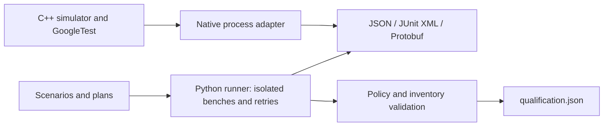

# HIL Bench

HIL Bench runs YAML test scenarios against software-simulated voltage,
temperature, and connection state. Python handles validation, retries, parallel
suite orchestration, reports, and policy-based release qualification. C++ provides
an independent simulator, GoogleTest tests, and Protobuf interoperability.

## Install and run

Use Python 3.10 or newer (CI checks 3.10–3.12) on macOS or Linux:

```bash
python3 -m venv .venv
source .venv/bin/activate
python -m pip install -e ".[dev]"
hil-run scenarios/smoke.yaml --report reports/smoke.json
python -m pytest -q
```

For a regular installation, use `python -m pip install .`. Generated Python
Protobuf bindings are included; Python-only execution does not require CMake or
protoc. Example scenarios, plans, policies, and tools are used from this checkout.

Verify wheel building and installation into a fresh temporary environment with:

```bash
python tools/verify_install.py
```

This downloads the declared build/runtime dependencies, runs the installed
`hil-run` outside the checkout, checks JSON and binary Protobuf output, and runs
the release demo with the isolated interpreter. Temporary installation files are
removed afterward. It requires package-index access.



## C++ simulation tests

Requires CMake 3.20+, a C++17 compiler, and Git on macOS or Linux.
The first configure needs network access to download pinned GoogleTest v1.17.0,
Protobuf v33.6, and Abseil sources.

```bash
cmake -S cpp -B build/cpp
cmake --build build/cpp
ctest --test-dir build/cpp --output-on-failure
hil-run --native-tests build/cpp/hil_bench_tests --native-timeout 30
```

Install the Python package first with `python -m pip install -e ".[dev]"`.
Native tests run in a separate process with their own simulator; they do not
share Python bench state. Use `--native-results` for individual GoogleTest outcomes,
or `--report reports/native.json` to capture them in a HIL report. Add
`--report-format junit` for JUnit XML. Report options automatically enable XML capture;
without them, raw native execution remains unchanged. Native mode supports
`--verbose` and `--quiet`. CLI exit codes are 0 for success, 1 for test failure,
and 2 for launch, timeout, or argument errors. YAML commands work as before.


To include the optional mixed-outcome reporting fixture, configure with
`cmake -S cpp -B build/cpp -DHIL_BUILD_REPORTING_FIXTURE=ON` and rebuild.
Run `python -m pytest -q -m native_integration` for real-binary reporting tests.
These tests skip when their binaries are absent; CI builds and requires both.
The intentionally failing fixture is separate from the passing CTest suite.

## Protobuf development

Python bindings are tracked; C++ bindings and compiled dependencies stay in `build/`.
Use Protobuf 33.6 (Python runtime 6.33.6) throughout. Regenerate Python bindings with
`python tools/generate_proto.py --protoc /path/to/protoc`; add `--check` to verify
that tracked bindings match the schema. Do not edit generated bindings manually.

CMake builds `protoc` and the C++ runtime from the same pinned source revision;
no system C++ Protobuf library is used. After building, run
`cmake --build build/cpp --target check_python_proto` to check Python generation.
Use `--report-format protobuf` with YAML or native CLI commands for binary reports
(default: `reports/latest.pb`). Existing binary reports may be replaced; unrelated
files and symlinks are refused.

Run `python -m pytest -q -m protobuf_integration` for real bidirectional exchange tests.
The utility supports `hil_proto_exchange produce OUTPUT RUN_ID [--fault]`,
`verify INPUT`, and `roundtrip INPUT OUTPUT`; it never replaces existing output files.
Its exit code describes successful validation/serialization, not the contained test outcomes.

## Tags, retries, and plans

YAML cases may set `tags: [smoke, thermal]` and `retries: 1`.
Use `--tag thermal` with a tagged suite; unknown tags return exit code 2.
Retries default to zero and permit at most three additional attempts, each with
a fresh simulated bench. Only supported assertion/connection failures are retried.
JSON preserves structured histories; JUnit system-out and Protobuf diagnostic
details retain prior attempts without changing the binary schema.

```bash
hil-run --plan plans/recovery.yaml --report-dir reports/batches --report-format junit
hil-run --plan plans/faults.yaml --fail-fast --quiet
```

Each batch gets a unique directory, individual suite reports, and a JSON manifest.
The fault plan intentionally returns exit code 1. Plan paths are relative to the
plan file. Native processes support configurable timeouts; Python steps have no
hard in-process timeout guarantee.


For independent software-simulated suites, opt into bounded thread workers:

```bash
hil-run --plan plans/recovery.yaml --workers 4 --report-dir reports/parallel
python tools/benchmark_parallel.py --workers 4
```

Plans may also set `workers: 4`; the CLI overrides that setting. The default is
one worker, with an allowed range of 1–8. Parallel results remain in plan order,
with separate bench state and suite reports. Worker exceptions fail the batch;
cases without complete outcomes are counted as `unreported_cases` in the manifest.
Parallel `--fail-fast` is rejected; use one worker for existing fail-fast behavior.
Workers apply only to simulated YAML batches, never native or physical devices.
Batch duration measures wall time, not summed suite durations. The opt-in benchmark
prints observed wall times; CPU-bound simulation may be slower with threads.


## Release qualification

```bash
hil-run --plan plans/recovery.yaml --qualification-policy policies/strict.yaml --workers 2 --report-dir reports/qualification
```

Qualification writes a separate `qualification.json` beside the batch manifest,
with criteria, observed counts, reasons, and execution IDs. Defaults require 100%
passing, zero failed or skipped cases, and no cases passing after retries.
`policies/tolerant.yaml` shows explicit alternative thresholds. Pass percentage uses
all planned cases, including skips; retry attempts never count as extra cases.
Missing or inconsistent evidence always prevents qualification. The Python evaluator
requires the original suite or plan inventory alongside completed in-memory results.

Exit codes remain 0 for execution and qualification success, 1 for failed tests or
rejected qualification, and 2 for configuration or report-writing errors. A lenient
policy does not hide a test-failure exit. Existing execution reports stay unchanged.
These policies evaluate simulated software tests, not physical hardware safety.

## Repeatable performance and reliability checks

Activate the project environment first (`source .venv/bin/activate`) and install
`python -m pip install -e ".[dev]"`. Python 3.10–3.12 are checked in CI.

```bash
python tools/benchmark_parallel.py --suites 8 --steps 2000 --workers 4 --repeats 20 --warmups 2 --output reports/benchmark.json
python -m pytest -q --cov --cov-report=term-missing --cov-report=xml:reports/coverage.xml
```

The benchmark is opt-in. Each suite runs one `voltage-cycle` case alternating
setting 5 V and asserting 5 V on the real Python simulator. Each run builds fresh
inputs and creates independent benches and in-memory reports; nothing is written
during timing. `perf_counter()` measures execution, including orchestration and
parallel input snapshots, but excludes workload construction and report export.
Sequential and parallel runs use the same steps and alternate measurement order.
Warm-ups are discarded. Synthetic clocks in unit tests verify arithmetic only.

Bounds: 1–128 suites, 1–100000 steps per suite, 1–100 repetitions, 0–10 warm-ups,
and 2–8 parallel workers (the sequential baseline always uses one).
JSON includes every observed duration in seconds, Python/OS versions, configuration,
median/minimum/maximum/mean, and speedup = sequential median / mode median.
A zero median gives null speedup. p95 appears only with at least 20 measurements,
using the sorted sample at one-based rank `ceil(0.95 * n)`. This is a descriptive
sample statistic, not a latency guarantee. Threads may be slower for this CPU-bound
workload. Compare results on the same machine and configuration.

Coverage measures statements and branches, including Python subprocesses, and
excludes generated Protobuf bindings. pytest-cov is a development dependency;
there is no enforced percentage threshold. CI runs deterministic stress tests
and exports coverage without asserting benchmark timing.

## Software-only release demonstration

From the repository root with the environment activated:

```bash
python tools/demo_release.py --workers 2 --output-dir reports/demo
```

The demo invokes the supported CLI for smoke (JSON), deliberate faults (JUnit),
and recovery (Protobuf), then runs the recovery and fault plans with
`policies/strict.yaml`. Single-suite outputs appear under `scenarios/<unique-id>/`.
It also exports individual binary Protobuf reports,
a JSON batch manifest, and `qualification.json` in a unique directory per batch.
The printed JSON shows each decision, observed case counts, individual criteria,
failure reasons, and run IDs linking the decision to execution evidence.
Recovery qualifies; faults intentionally fails two cases and is rejected.
The demonstration returns 0 when both expected outcomes are reproduced and 2 on
an unexpected outcome or configuration/publication error. The existing `hil-run`
exit codes are unchanged. Repeated demos preserve earlier outputs. All reports
and coverage artifacts are ignored by Git. This validates simulated software
behavior only; it makes no real hardware or safety certification claim.

## Inspect reports and limitations

The demo prints report paths and qualification decisions as JSON. Open
`batch.json` for ordered suite outcomes and links to each suite report, and
`qualification.json` for criteria, counts, and evidence references. JUnit XML can
be opened in a CI test viewer. Decode a binary report from the active environment:

```bash
python -c 'from pathlib import Path; from hil_automation.protobuf import parse_result; print(parse_result(Path("reports/latest.pb").read_bytes()))'
```

Replace the example path with a generated `.pb` path. JSON retains structured
retry histories; JUnit stores histories in `system-out`, and Protobuf stores them
in diagnostic text. Qualification accepts validated in-memory executions and the
original inventory, rather than importing arbitrary report files.

This project tests software simulation only. It has no physical device adapters,
real-time guarantees, or safety certification. Python steps have no hard timeout;
native subprocesses do. Parallel workers apply to simulated suites, and parallel
fail-fast is unsupported. C++ integration tests require built binaries; otherwise
they skip locally. CI builds the binaries and runs those tests explicitly.
